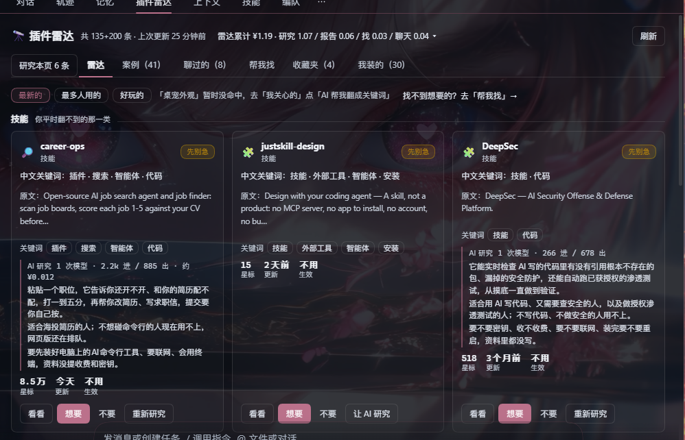
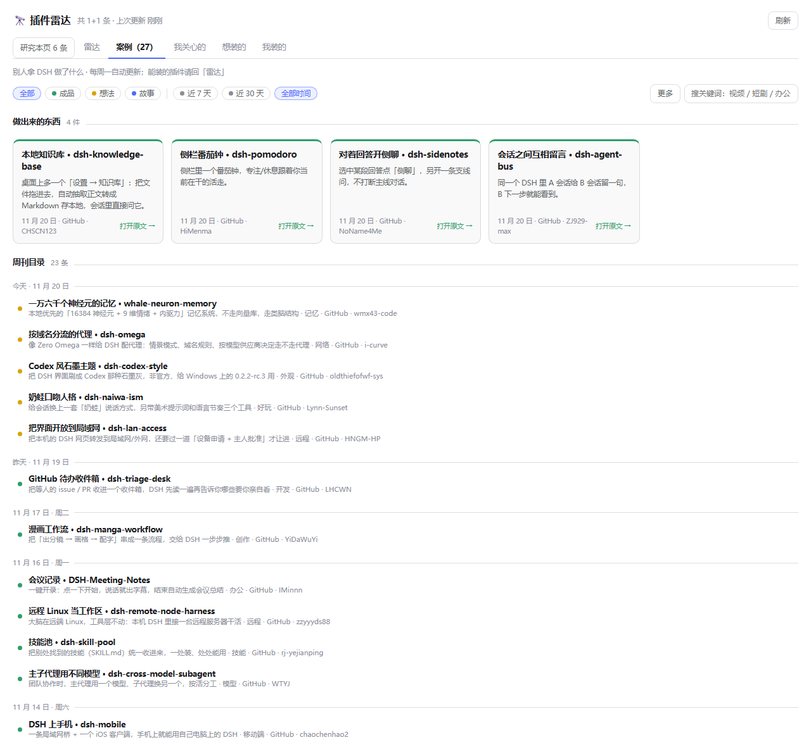
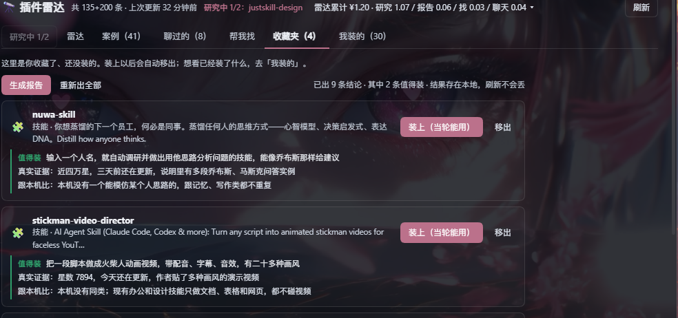
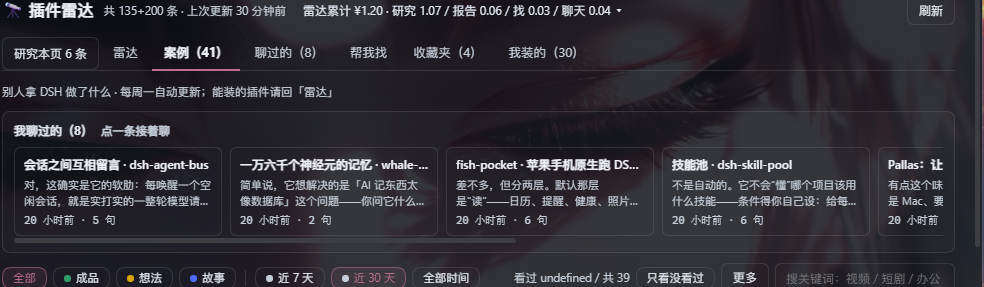

# 插件雷达工作台 · dsh-plugin radar workbench

> 给 DeepSeek Harness 桌面端装一个「页签」：把插件和技能的真实数据摆到你面前，用大白话告诉你能装不能装，看中了直接点一下装上。
>
> A plugin/skill discovery workbench for DeepSeek Harness: real npm + GitHub numbers, plain-language advice, one-click install, and an AI that reads the README for you.

当前版本 **0.8.2**（看 [CHANGELOG.md](./CHANGELOG.md)）。

---









## 它解决什么问题

DSH 的插件生态散在两个地方：插件在 npm，技能在 GitHub。名字一堆英文，说明是给作者自己看的，你没法判断「这个东西是干嘛的、能不能装、装完会不会跟我已经有的打架」。

这个工作台把它变成一句话：**可以装 / 先别急 / 不建议**，理由写在卡片上。看不明白的英文条目，点一下让模型读它的说明、写三句中文，还告诉你这一下花了多少钱。

## 六个页签

| 页签 | 干什么 |
|---|---|
| **雷达** | 插件 / 技能 × 最新 / 热门 / 好玩。每张卡带真实数字（npm 月下载量、GitHub 星数、多久没更新）和一句白话建议 |
| **案例** | 一批真实做过的小东西（成品 + 周刊目录），每条能就地聊，也能让它「拉源码」读真代码再回答 |
| **聊过的** | 竖向一条一行，名字 + 最后一句 + 多久前。能搜、能勾选批量删，删前一定确认 |
| **帮我找** | 一句话（「帮我找做小游戏的插件」）→ 模型翻成中英搜索词 → 真去 npm 和 GitHub 搜 → 出卡片，可直接装 |
| **收藏夹** | 点过「想要」的都在这。一键出报告：逐条查资料 + 跟你已装的比一遍，结论三条写在每条下面 |
| **我装的** | 列出本机插件与技能，标明「要重启才生效 / 当轮就能用」，装之前先看你有没有同类的 |

## 装

需要 DSH 桌面端（本仓库按 0.2.x 内核验证）。

```bash
# 从本仓库目录装（link 方式，改代码立即生效）
dsh plugin --profile desktop add "<本仓库绝对路径>"

# 或从 GitHub 装
dsh plugin --profile desktop add "github:<你的用户名>/dsh-radar-workbench#<commit>"
```

装完**完全退出再打开** DSH（托盘退出，不是关窗口）——宿主侧代码只有重启才加载。

卸：

```bash
dsh plugin --profile desktop remove dsh-plugin-radar
```

## 数据放在哪

全部在 `~/.dsh/dsh-plugin-radar/`，删掉会自动重建：

| 文件 | 内容 |
|---|---|
| `cache.json` | 抓回来的榜单，6 小时内不重复联网 |
| `state.json` | 口味词、收藏夹、点过「不要」的 |
| `notes.json` | AI 短评 + 每次的 token 用量与折算费用 |
| `case-chats.json` | 案例就地聊天的记录（删这个只删聊天，不动案例本身） |

**不联网也能用**：宿主没起来或断网时自动退成样例，并在页面上写明「这是样例」。

## 自测

```bash
npm test          # 218 项：逻辑 / 渲染 / 接口 / 限流
```

四份测试分别是 `radar` 76、`client` 103、`routes` 35、`limit` 4。`radar` 的 B 段会真联网抓一轮（GitHub 匿名限额用完只提示、不算失败）。

## 已知边界

- 技能不是 npm 包，不做「一键装」，只给一条精确的 `git clone` 命令。
- GitHub 匿名接口 60 次/小时。读源码失败时自动换 jsDelivr 备用源。
- 只读用户级技能目录（`~/.agents/skills`、`~/.dsh/skills`），插件自带的技能不在磁盘上，读不到。
- 界面按桌面端做，没做手机适配。

## 许可

[MIT](./LICENSE)。跟 DSH 本身没有官方关系，是第三方插件。
